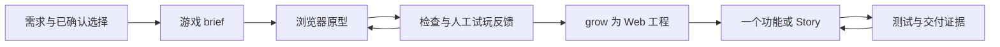

# Codex 游戏开发工作流

先读取 AGENTS.md，再用 `$start` 或明确选择本仓库 Skill。需求已经是“做一个游戏”时进入 prototype；已有 HTML 可通过 prototype --from 导入副本，保留原游戏。

collaborative 默认展示选项与草稿，按批准范围写入；guided 和 autonomous 的区别见共享协作规则。已有授权沿用，必要问题未回答就等待。
原型不以人工未试玩自动判定 PROCEED；保留运行截图、原话 checklist 和未评估项。玩法、数值、视觉与试玩质量分别判断。

grow 保留原型副本，完成参考回放、复制、TypeScript 化、规则测试、配置记录及同 seed 对比。引擎状态进入 project.yaml 和 docs/engine-reference，根 AGENTS 不被引擎设置改写。

工作室模式下，设计 GDD → 架构 ADR/TR → Epic/Story → readiness → dev-story → code-review → story-done；具体产物按 workflow 和严格度决定。
Proposed ADR 不能当作 Accepted；可见变化需要实际运行与保留截图。注册表 ID 不重新编号，control manifest 版本在故事中核对。

团队规模、评审深度、文档严谨度和自动化模式是独立配置。先说明实际参与角色，独立任务可并行，同文件写入及有依赖阶段串行。
会话恢复读取 production/session-state/active.md；缺工具或缺产物明确未评估。详细节点与下一步由 .agents/docs/workflow-catalog.yaml 和各 Skill 维护。
